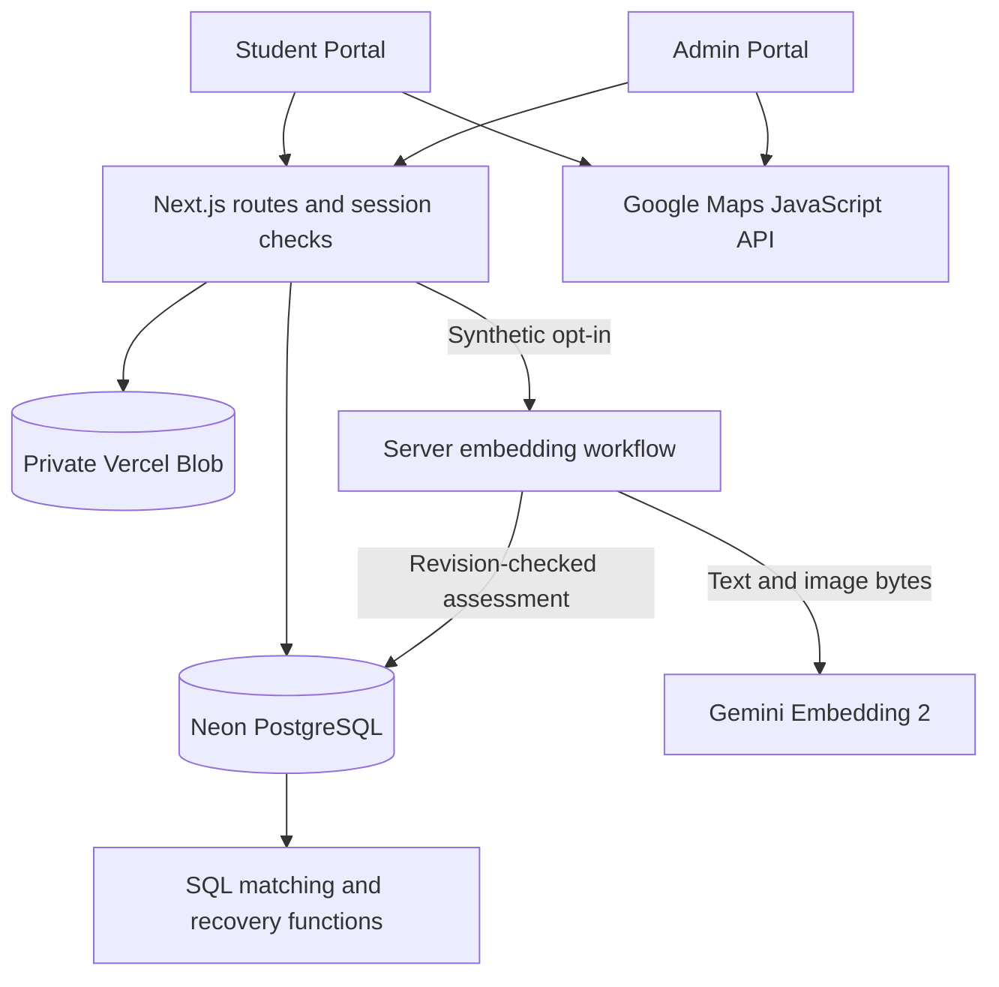
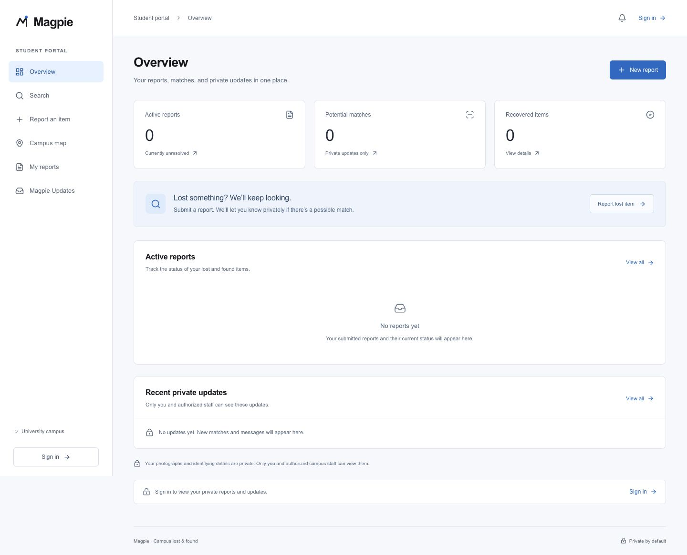

<div align="center">

<h1>Magpie</h1>

<p><strong>A smarter, privacy-first way to reunite campuses with lost belongings.</strong></p>

<p>Built by a four-person team for HackOHI/O 2026.</p>

<p>
  
  
  
  
  
  
  
</p>

</div>

Magpie connects private student lost reports with staff-managed found inventory. Compatibility-first matching, optional multimodal Gemini comparisons, and controlled pickup help staff reunite belongings with owners without publishing identifying evidence.

**Repository guide:** the Next.js application, lockfile, scripts, and environment example live in **[`reclaim/`](reclaim/)**. This guide describes `integration/final-hackathon`.

## Contents

| Explore the project | Build and verify |
| --- | --- |
| [Why Magpie](#why-magpie) · [The problem](#the-problem) | [Architecture](#architecture) · [Technology stack](#technology-stack) |
| [The recovery journey](#the-recovery-journey) · [Features](#features) | [Getting started](#getting-started) · [Database setup](#database-setup) |
| [Gemini AI-powered matching](#gemini-ai-powered-matching) · [How matching works](#how-matching-works) | [Configuration](#configuration) · [Testing and verification](#testing-and-verification) |
| [Screenshots and demonstration](#screenshots-and-demonstration) | [Limitations and next steps](#limitations-and-next-steps) |
| [Team and acknowledgments](#team-and-acknowledgments) | [Hackathon project](#hackathon-project) |

## Why Magpie

We built Magpie to connect students, intake locations, and staff through a clear campus recovery path.

Magpie is **campus-configurable**: branding, map center, buildings, and published intake desks can change. Ohio State Columbus is the bundled example. This is a single-campus installation, not completed multi-tenant university infrastructure.

## The problem

Information fragments across buildings, social posts, and spreadsheets. Students struggle to search; staff manually coordinate custody. Publicly identifying photos or marks give dishonest claimants the evidence owners would use.

Magpie separates **discoverability** from **proof of ownership**: broad summaries help people search; private evidence supports staff decisions.

## The recovery journey

1. A student privately reports a **LOST** item, with optional photos and location.
2. A finder physically brings a **FOUND** item to campus staff.
3. Authenticated staff receive it and create the found report in the Admin Portal. **Students cannot create found reports.**
4. Magpie filters incompatible pairs and ranks compatible candidates.
5. Staff review reports privately; the student submits ownership evidence and can answer information requests.
6. Approval supplies private pickup instructions and a single-use pass.
7. Staff verify the handover and redeem the code. Both reports become **Returned**, protected against stale competing approvals.

Matching suggests candidates. Staff, rather than an AI score, authorize the return.

## Features

### Student Portal

- Email-based demo sign-in; lost-item reporting with category-specific fields.
- Up to three private photos, **25 MB per image**; JPEG, PNG, WebP, HEIC, and HEIF, with preview/download fallback.
- Building search, Google Maps point selection, and unknown-location reporting.
- Privacy-safe Search, owned **My Reports**, eligible editing/deletion, and **Magpie Updates**.
- Private claim evidence, additional-information responses, pickup passes, and recovery status.
- Staff-approved drop-off guidance with public instructions and building locations.
- Manual/focus refresh and bounded polling, with visible loading and failure states.

### Admin Portal

- Separate staff credential sign-in and server-protected pages/APIs.
- Found-item intake, custody management, report filters, and private photo comparison.
- Matching classifications, factors, private explanations, and optional confirmed Gemini comparisons.
- Claim approval/rejection, private information requests, response review, and activity history.
- Manual pickup-code redemption and expired-pass renewal that invalidates the previous code.
- Active intake zones with explicit student-publication controls; internal instructions remain separate.

### Privacy and access controls

Server-side ownership and role checks restrict reports, photos, claims, and correspondence. Public Search exposes only technical ID/type, broad category, general building, date, and generic status—not item names, identifying descriptions, photographs, or contact details. Photos use **private Vercel Blob** storage and authenticated reads.

**Demo identity is not verified identity.** Student email sign-in does not prove email ownership; use synthetic data. Staff use a separate credential session. These controls do not replace production university SSO or a complete security review.

## Gemini AI-powered matching

The optional server-only integration uses the official `@google/genai` SDK with **Gemini Embedding 2** (`gemini-embedding-2`) and **768-dimensional embeddings**:

| Available input | Comparison |
| --- | --- |
| Both item descriptions | Text-to-text semantic similarity |
| Both permitted photographs | Image-to-image similarity |
| One photograph and the opposite description | Cross-modal image-to-text similarity |

Validated, normalized vectors are compared using cosine similarity; negative values are clipped to zero. Missing or failed responses never produce fabricated embeddings.

Staff explicitly select a synthetic pair and confirm permitted Google processing. **Report creation and intake remain deterministic and never wait for Gemini.** Compatibility is checked before inference or private image access, then checked again before a revision-validated SQL update. Provider timeout, unavailable configuration, or unusable modalities preserve deterministic fallback; successful partial modalities can still contribute.

The workflow prepares at most one authorized photo per report as a bounded, metadata-stripped JPEG. Google receives permitted item names/descriptions and prepared bytes—not Blob URLs, ownership answers, identities, coordinates, or staff notes. Embeddings remain transient in a bounded server cache; PostgreSQL stores private assessment/provenance, not a vector database.

**Synthetic-demo-only privacy boundary:** a key alone cannot enable processing. Both server gates and staff confirmation are required. Real-student AI processing is unsupported until owner consent, revocation, identity, and provider data-handling policies are implemented. Staff demo confirmation is not real-user consent.

**Live verification passed on 2026-10-25:** the recorded run verified real text, image, and cross-modal embeddings, semantic ranking improvement on the authored fixture, and a staff comparison using a bound private Blob photo. Generated swatches establish transport, not object-recognition quality; live HEIC decoding remains unverified. See [Gemini implementation and evidence](reclaim/memory/GEMINI_MATCHING.md).

## How matching works

### Stage 1: compatibility filtering

Normalization handles bounded brand/model aliases, color synonyms, categories, and generic item types. Reliable contradictions reject a pair **before ranking**. Unknown or ambiguous fields abstain; missing locations and movement between buildings do not cause automatic rejection.

> **Lost:** Apple AirPods Pro<br>
> **Found:** Samsung Galaxy Buds<br>
> **Result:** **No Match**. Known brand/model contradictions take priority over similar descriptions or images; Gemini is not called for this rejected pair.

### Stage 2: weighted ranking

Compatible candidates combine available signals:

| Signal | Default weight |
| --- | ---: |
| Measured image or cross-modal similarity | 30 |
| Description | 20 |
| Brand/model/category/type attributes | 20 |
| Color/details | 10 |
| Location | 10 |
| Time | 10 |

Missing signals are omitted and weights redistributed. Description combines lexical overlap with measured semantic similarity when available. Sparse identity evidence is capped below the candidate threshold. Classifications are Very Strong/Strong Match, Possible Match, Weak Match, and No Match; the staff UI groups strong classifications as **Strong potential match**. Rankings are relative indices, **not ownership probabilities**.

For example, an unknown-brand black backpack can remain eligible for a compatible found backpack. That does not infer its brand or establish ownership. Full identifiers can be compared when explicitly supplied to the evaluator, but current intake does not capture that map. [Reproducible demo cases](reclaim/memory/MATCHING_DEMO_CASES.md) distinguish these limits from working behavior.

## Architecture



React portals call Node.js Route Handlers; Neon stores application state and transactional SQL enforces recovery. Uploads go directly to Blob using scoped server-issued tokens; the server proxies authorized private reads. Gemini comparisons run separately from immediate SQL matching.

Student and staff sessions use separate opaque tokens in HttpOnly, SameSite cookies, marked Secure in production; Neon stores token hashes. Staff authorization is checked independently on each protected API.

## Technology stack

| Layer | Technology and responsibility |
| --- | --- |
| Frontend | Next.js 15, React 19, TypeScript; student and staff interfaces |
| Backend | Next.js Node.js API routes; validation, sessions, authorization |
| Database | Neon PostgreSQL, parameterized queries, transactional functions |
| Storage | Private Vercel Blob; original images and optional previews |
| Maps | Google Maps JavaScript API; campus display and point selection |
| AI | Optional Gemini Embedding 2 through `@google/genai` |
| Image preparation | `sharp`, `heic-decode`, browser `heic2any` |
| Testing | Node test runner, `tsx`, PGlite, synthetic Playwright browser harnesses |

Supabase SQL is retained as historical reference/testing material; it is not the runtime backend.

## Getting started

Use **Node.js 22.13+**, npm, authorized service configuration, and the integrated branch:

```sh
git clone https://github.com/AmritM05/LostAndFound.git
cd LostAndFound/reclaim
git switch integration/final-hackathon
npm ci
```

Create `.env.local` from [`.env.example`](reclaim/.env.example) **only if it does not already exist**:

```sh
# macOS/Linux; do not overwrite an existing file
test -f .env.local || cp .env.example .env.local
```

On PowerShell, use `if (!(Test-Path .env.local)) { Copy-Item .env.example .env.local }`. Fill values privately, complete the authorized [database setup](#database-setup), then run:

```sh
npm run dev
```

Visit [localhost:3000](http://localhost:3000), or the alternate port Next.js prints. Student sign-in is `/login/`; staff sign-in is `/admin/login/`. Gemini is optional: leave its gates disabled for deterministic matching. Missing Neon or Blob configuration reports an error; there is no runtime fake-success database.

## Database setup

Use a dedicated, authorized Neon database. The [migration runner](reclaim/scripts/migrate.mts) applies sorted SQL, then upserts configured buildings:

| Order | Migration | Responsibility |
| --- | --- | --- |
| 001 | `001_student_backend.sql` | Core schema, private reports, safe search |
| 002 | `002_report_deletion.sql` | Recovery-aware deletion and cleanup outbox |
| 003 | `003_admin_portal.sql` | Staff sessions, intake, initial recovery/matching |
| 004 | `004_admin_recovery.sql` | Terminal-state guards and information workflow |
| 005 | `005_matching_engine.sql` | Compatibility-first matching and private reasoning |
| 006 | `006_pickup_reissue.sql` | Safe expired-pass renewal |
| 007 | `007_student_dropoff_visibility.sql` | Explicit publication and public instructions |
| 008 | `008_gemini_matching.sql` | AI revision validation and guarded persistence |

```sh
# Only for an explicitly authorized, reviewed database target
npm run db:migrate
npm run services:check
```

The runner replays files without a migration ledger. Each file commits separately; earlier commits survive a later failure. Pause application writes during coordinated replay because older definitions precede replacements. Never run only migration 003 afterward or apply archived Supabase SQL. Fresh desks remain hidden until staff create/activate and explicitly publish them.

**Latest recorded deployment:** the authorized disposable Neon target received **004–008 in order** after confirming 001–003 already existed. Schema/function checks, private Blob processing, and synthetic live recovery passed. This does not authorize another target or certify hosted HTTPS deployment. See [migration verification](reclaim/memory/DATABASE.md) and [deployment evidence](reclaim/memory/FINAL_INTEGRATION_PLAN.md).

## Configuration

Supply these [environment example](reclaim/.env.example) settings privately:

| Purpose | Environment variable names |
| --- | --- |
| Required persistence/storage | `DATABASE_URL`, `BLOB_READ_WRITE_TOKEN` |
| Required staff demo access | `ADMIN_DEMO_EMAIL`, `ADMIN_DEMO_PASSWORD` |
| Interactive maps | `NEXT_PUBLIC_GOOGLE_MAPS_API_KEY`; optional `NEXT_PUBLIC_GOOGLE_MAPS_MAP_ID` |
| Campus overrides | `NEXT_PUBLIC_CAMPUS_CONFIG`, `NEXT_PUBLIC_CAMPUS_NAME`, `NEXT_PUBLIC_CAMPUS_LAT`, `NEXT_PUBLIC_CAMPUS_LNG`, `NEXT_PUBLIC_PICKUP_LOCATION`, `NEXT_PUBLIC_ALLOWED_EMAIL_DOMAINS` |
| Optional hosting/upload settings | `ALLOWED_ORIGINS`, `VERCEL_BLOB_CALLBACK_URL` |
| Optional AI | `GEMINI_API_KEY`, `GEMINI_EMBEDDING_MODEL`, `MAGPIE_AI_MATCHING_ENABLED`, `MAGPIE_AI_DEMO_MODE`, `MAGPIE_AI_MATCHING_WEIGHTS` |
| Opt-in live Gemini test | `MAGPIE_RUN_LIVE_GEMINI_TEST` |

Use a **private** Blob store. Never prefix database, Blob, staff, or Gemini secrets with `NEXT_PUBLIC_`. The Maps browser key is public by design; restrict its API/referrers. Maps failures still permit building/unknown-location reports. Campus JSON configures branding, center, and buildings; it does not provide tenant isolation or automatically retire old database buildings. Demo sign-in does not enforce the domain allowlist as verified university membership.

For synthetic Gemini comparisons, select model `gemini-embedding-2`, enable both AI/demo gates, and confirm synthetic input in staff Matches. Optional weights use the factor names above; malformed overrides fall back to defaults. Restart after server-setting changes and rebuild after browser-public changes. Deploy as a Node-capable Next.js application with project root `reclaim/`, not a static `out/` directory.

## Testing and verification

Run from `reclaim/`:

```sh
npm test
npm run typecheck
npm run build
```

Latest recorded results (**2026-10-25**, [final live-verification report](reclaim/memory/VERIFICATION.md)):

| Evidence | Recorded result and scope |
| --- | --- |
| Automated suite | **139 passed**, no failures/skips; math, normalization, authorization, mocked providers/images, isolated SQL/repositories and persistence |
| TypeScript / production build | Passed; compilation is not infrastructure verification |
| Synthetic browser checks | **36 scenarios passed**; intercepted student APIs and staff component harnesses, kept separate from live evidence |
| Live Gemini inference | **Passed** for real 768-dimensional text, visual, and cross-modal comparisons; swatches are transport evidence |
| Live recovery driver | **14 passed**, including 13 workflow/privacy subtests; actual HTTP, Neon and private Blob operations on the authorized synthetic target |
| Live browser rehearsal | **14 passed**; real local UI, private responses, mobile navigation, published desks and Maps readiness |
| Hosted HTTPS deployment | Not verified; production compilation and local development-mode rehearsal are separate evidence |

Tests use synthetic data and PGlite; some retained suites exercise archived Supabase SQL. [Test harness documentation](reclaim/tests/README.md) and the [demo runbook](reclaim/memory/DEMO_RUNBOOK.md) distinguish browser fixtures from the opt-in real-service driver. Frozen migration audits overlap suite coverage and are not extra test totals.

```sh
# Explicitly enabled synthetic provider test, after private configuration
MAGPIE_RUN_LIVE_GEMINI_TEST=true npm run test:gemini:live
```

This requires both AI/demo gates and a key. See [live-test source](reclaim/tests/gemini.live.mts) and [live browser rehearsal](reclaim/tests/live-browser.rehearsal.mjs). Re-run only on an authorized synthetic target; mocked tests never substitute for provider measurements.

## Screenshots and demonstration



*Earlier development capture; not a current deployment or Gemini verification.*

**Recorded video:** not supplied. Maintainers can add its URL after rehearsal. Use synthetic data; avoid exposing credentials, pickup codes, or real private evidence. See the [demo cases](reclaim/memory/MATCHING_DEMO_CASES.md) and [runbook](reclaim/memory/DEMO_RUNBOOK.md).

## Limitations and next steps

- **Identity:** email-only student login and shared staff demo credentials need replacement with verified campus identity and scoped staff accounts.
- **Matching:** visually indistinguishable objects can rank highly. Full identifiers are evaluator-only; intake does not yet capture them. Independent PostgreSQL contention and simultaneous-insert discovery are not proven by single-session PGlite tests.
- **AI:** synthetic-only; live transport does not establish object-recognition accuracy or calibrated ownership probabilities. Real-user consent and provider data-handling review remain prerequisites.
- **Operations:** hosted HTTPS acceptance, scheduled abandoned-upload cleanup, pagination, stronger audit/retention controls, and found-intake retry idempotency remain work.
- **Campus growth:** configuration is implemented; multi-campus tenancy, campus integrations, and robust dataset migration are future improvements. Correspondence is report-scoped rather than linked to individual information requests.

The [memory index](reclaim/memory/README.md) preserves dated evidence; current source and newest updates supersede historical baselines.

## Team and acknowledgments

Magpie was built by **three teammates for HackOHI/O 2026**:

| Contributor role | Responsibility |
| --- | --- |
| Developer 1 — name/profile to be supplied | Student experience and final integration |
| Developer 2 — name/profile to be supplied | Admin recovery and optional Gemini integration |
| Developer 3 — name/profile to be supplied | Compatibility-first matching and matching QA |

Maintainers can add approved contributor credits. We thank HackOHI/O and the maintainers of the open-source libraries used here.

## Hackathon project

Built for HackOHI/O 2026, Magpie connects private reporting, physical custody, multimodal comparisons, and guarded returns. Its technical work spans authorized photo transport, role separation, missing-data-aware ranking, provider failures, and terminal recovery states.
