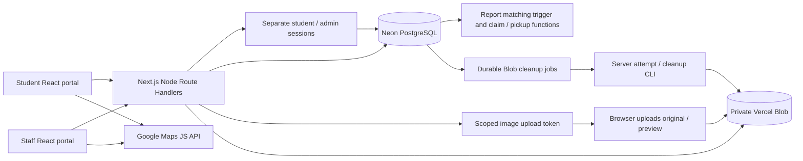

# Architecture

## Integrated snapshot — 2026-10-25 (supersedes historical baseline below)

All frozen branches are merged into `integration/final-hackathon`: student `a686d21`, admin `3e8b18d`, matching `cefd1c5`. The lead lifted the merge hold. Main remains unchanged and Draft PR #2 remains unmerged. Student drop-off guidance consumes the authenticated published-desk API; staff views show private matching classification/reasoning and ranking indices. Compatible/contradictory/unknown demo scenarios and recovery terminal guards pass local acceptance.

Final verification: **119 automated tests passed, zero failures/skips/TODO**, TypeScript and production build passed; **36 synthetic browser scenarios** passed (16 student recovery/drop-off, 10 intake/deletion/search, 10 staff desktop/mobile). Frozen ordered **001–007** local SQL audit also passes separately (overlaps full-suite coverage). No real photo upload/auth/recovery run occurred. Read-only Neon/Blob checks pass, but 005/006/007 schema markers are missing and recovery bodies differ from 004. **Remote migration writes remain unauthorized; complete live recording is blocked.** See [FINAL_INTEGRATION_PLAN](FINAL_INTEGRATION_PLAN.md), [VERIFICATION](VERIFICATION.md) and [DEMO_RUNBOOK](DEMO_RUNBOOK.md).

### Historical baseline (not current integrated behavior)

## Current system

Next.js App Router serves React 19/TypeScript pages and Node.js Route Handlers in one application. `next.config.ts` uses trailing slashes, a configurable build directory and unoptimized images; there is no static-export mode. TypeScript currently has `strict: false`. Next.js is declared at the 15.5 release line; exact installed versions come from the lockfile.

The diagram describes live code paths, not a proposed AI service. All external service health is environment-dependent.

## Directory map

| Application path | Responsibility |
| --- | --- |
| `app/` | Global layout, CSS, metadata, student/admin pages, API routes |
| `components/portal/Portal.tsx` | Actual student shell, search, reports, updates, map and dialogs; also contains unused legacy admin branches |
| `components/admin/` | Actual staff shell and staff sign-in; does not use the legacy admin branches |
| `components/portal/ReportForm.tsx` | Shared lost/found form; its mode is presentation, authorization stays on the server |
| `components/portal/EditLostReport.tsx` | Owner report editing, without image replacement |
| `components/PhotoUploader.tsx`, `PrivatePhoto.tsx`, `DeleteReportAction.tsx` | Shared photo UX, private rendering/downloads, explicit delete confirmation |
| `components/BuildingSelector.tsx`, `CampusMap.tsx` | Campus building autocomplete and interactive map |
| `services/` | Relative-URL browser adapters, score helper, placeholder image analysis and tests |
| `lib/server/` | Server-only connection, session, authorization, repositories, Blob and error helpers |
| `lib/campus.ts`, `lib/campuses/` | Config parsing, bundled OSU buildings and search |
| `lib/uploadConfig.ts`, `imagePreview.ts` | Shared 25 MB policy and optional local image conversion |
| `db/migrations/` | Desired Neon schema and transactional business logic |
| `scripts/` | Migration/seed, service health, Blob retries, campus seed generation |
| `supabase/` | Archived SQL, still exercised by some regression tests |
| `.openai/hosting.json` | Historical static Site configuration targeting `out`; not a server deployment definition |
| `memory/` | Persistent project and team documentation |

The Git parent also contains historical screenshots. Screenshots are not implementation evidence by themselves.

## Frontend and route composition

`app/page.tsx` renders the student Portal overview. `app/student/[section]/page.tsx` statically enumerates six student sections. Student shells may render without a session, but private API data requires one. `/login` and `/signup` share AuthForm and the email-only server endpoint. The active staff route group `app/admin/(portal)/` checks the admin session server-side; `/admin/login` sits outside it. Unknown staff sections return notFound.

`useWorkspace` retrieves the student session then owned data, reacting to same-window workspace events and browser storage events. It has no polling, push subscription or window-focus refresh. Staff components load their own session/workspace and offer Refresh. There is no Next.js middleware or Server Action implementation in the inspected source; authorization is in layouts and Route Handlers.

## Backend and persistence

`lib/server/db.ts` validates a Neon connection and uses the serverless driver's HTTP parameterized queries. `repository.ts` projects owner-scoped student data. `adminRepository.ts` returns full private reports and staff collections only behind `requireAdmin`. Domain writes call SQL functions so report/image association, claim decisions and pickup changes are transactional. Repositories and SQL must evolve together.

`scripts/migrate.mts` uses a WebSocket Pool to apply every sorted SQL file, then upserts configured buildings. It replays idempotent migrations and does not maintain a migration ledger. Never casually apply this command to a teammate's production database. See DATABASE and TEAM_COORDINATION before adding migration files.

## Photos and service boundaries

Selection → shared validation → authenticated reservation with `upload_role` → short-lived scoped client token → direct private Blob upload → authenticated metadata verification → bind completed image IDs in the report transaction. Admin image requests explicitly carry `workspace=admin`; query parameters select which session to require and never themselves grant authorization. Large originals use multipart; JSON route bodies stay small. Originals and optional WebP previews are independent. Failed report-photo deletion goes through a durable outbox and manual retry command.

## Matching and state transitions

The active matcher is a PostgreSQL trigger installed in migration 003. `services/matchingService.ts` is a TypeScript scoring/reference helper used by tests; it is not a browser AI integration. Both must be considered when changing scoring. `services/imageAnalysisService.ts` is a placeholder. Claims, pickups and notices use existing relational tables, not a public chat or a background notification service.

## Dependency order and integration boundaries

- Session configuration and migrated Neon schema precede any persistent login or private workflow.
- Active database buildings precede selected-building validation; active drop-off zones precede found intake and approved pickup.
- Blob configuration plus upload-role migration precede photo reservation/finalization.
- Reports and matching trigger precede match notifications, claims and pickup.
- Approval precedes a pickup code; redemption precedes Returned status.
- Deletion authorization and outbox transaction precede physical Blob cleanup.
- Future compatibility/AI changes require a shared matching contract, schema strategy, SQL/TypeScript parity tests and privacy review before consumer UI changes.

No runtime in-memory success fallback exists. Local PGlite databases are test fixtures only. See [API contracts](API_CONTRACTS.md) and [team coordination](TEAM_COORDINATION.md).
